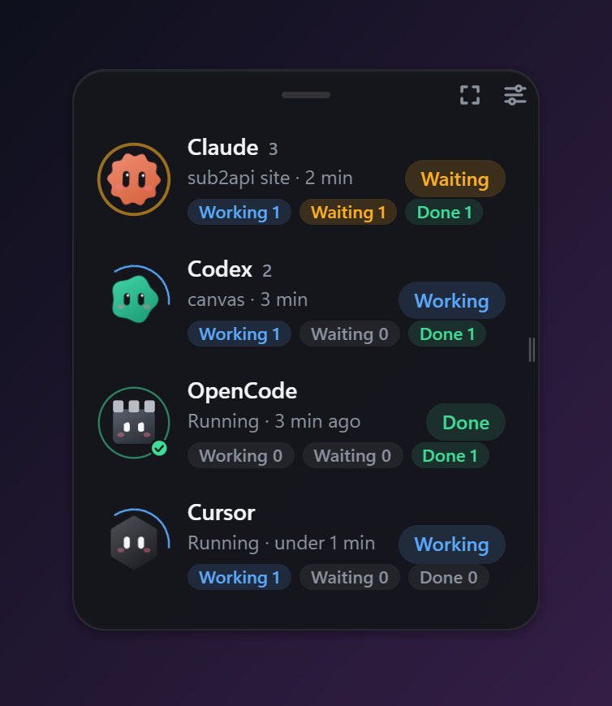
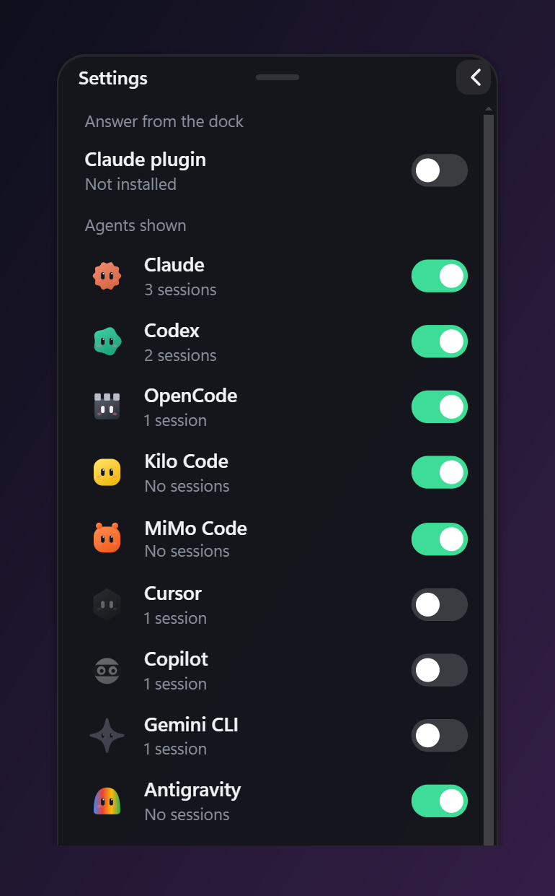

<p align="center">
  
</p>

<h1 align="center">Agent Dock</h1>

<p align="center">
  <strong>Is your coding agent working, waiting for you, or done?</strong><br>
  A small always-on-top window that answers it at a glance, for 27 agents.
</p>

<p align="center">
  <a href="https://www.microsoft.com/windows"></a>
  <a href="https://www.electronjs.org/"></a>
  <a href="https://nodejs.org/"></a>
  <a href="LICENSE"></a>
  
  
  
</p>

<p align="center">
  <strong>English</strong> · <a href="README.zh-CN.md">简体中文</a> ·
  <a href="#quick-start">Quick start</a> ·
  <a href="#supported-agents">Supported agents</a> ·
  <a href="#how-it-works">How it works</a>
</p>

<p align="center">
  
</p>

You start a task in Claude Code, another in Codex, a third in OpenCode, then go back to your own work.
Agent Dock sits on the edge of your screen and shows, for every agent, one of three states:

| State | Meaning | What you see |
| --- | --- | --- |
| **Working** | The agent is busy | Its bot bobs and blinks inside a spinning blue ring |
| **Waiting** | It needs an answer or an approval from you | A larger bot in a pulsing amber ring |
| **Done** | It finished its turn | A calm bot with a green check |

No quotas, no token charts, nothing to configure first. It only reads files your agents already write.

## Features

- **One bot per agent.** 27 hand-drawn mascots, each with its own shape and colour.
- **Resizes with its content.** Drag the left or right edge: the layout changes with the width, from icons only to a full panel with per-state counts. The height always follows the content, so nothing is cut off and there is no empty space.
- **Click a row to open it.** The window grows to show that agent's sessions. Close the rows and it returns to exactly the previous size and position. Agent rows and session lines light up under the mouse, so you can see what a click will hit.
- **A raised hand with a count.** The corner of an agent's mascot shows a hand and how many of its sessions are waiting for you; the tray tooltip shows the total.
- **Unread.** When a Claude or Codex session finishes a turn while the dock is watching, its green ring and check **blink** until you click its row. For the other agents, which are read from file activity, it blinks only when activity that lasted at least 30 seconds stops; that means "activity stopped", not "finished". A Codex turn that goes quiet for 30 minutes and then finishes is not flagged. If something else of that agent is still working, a small blinking green dot marks the mascot instead. The tray tooltip counts unread sessions.
- **A short summary of what finished.** For Claude and Codex, a finished turn that you have not looked at shows its last message (about three lines) in a green card. Choose **Open chat**, **No reply** (dismiss it), or, for Claude, type a follow-up right there and send it as your next message (it uses the optional Claude plugin, like answering a question).
- **Open the chat from the dock.** A click can jump to the session's chat: for sessions of the Claude desktop app (through the app's own `claude://code/continue` link; terminal sessions have no desktop chat) and OpenCode (its window comes forward). It is a switch in Settings; a row with one session opens its chat directly, and if it cannot be opened the row expands as usual. A row with several sessions expands, and a click on one of its sessions opens it.
- **Per-state counts.** `Working 2 · Waiting 1 · Done 5` for every agent.
- **Pick your agents.** Settings lists every supported agent, installed ones first, with a switch for each.
- **English and 中文.** English is the default; switch in Settings.
- **Answer from the dock.** A question Claude's desktop app is waiting on shows up with its buttons and a text field; click, and the answer goes into that session (optional Claude plugin, off by default).
- **Read-only by default.** It never edits an agent's configuration and sends nothing anywhere; only the optional Claude plugin, which you turn on yourself, adds one plugin to Claude.
- **Desktop shortcut** with a global start key (`Ctrl+Alt+H`).

## Download

Get `Agent-Dock-Setup-<version>.exe` from the [latest release](https://github.com/kjw0716/agent-dock/releases/latest) and run it. It installs for the current user (no admin rights) and adds a Start menu shortcut. The installer is not code-signed, so Windows SmartScreen may show "Windows protected your PC": choose **More info** > **Run anyway**.

## Run from source

You need Windows 10 or 11, [Node.js](https://nodejs.org/) 20 or newer and Git. (The screenshot script `scripts/shoot.js` needs Node 22 or newer.)

```powershell
git clone https://github.com/kjw0716/agent-dock.git
cd agent-dock
npm install
npm start
```

Create the Desktop and Start menu shortcuts (it can then be started with <kbd>Ctrl</kbd>+<kbd>Alt</kbd>+<kbd>H</kbd>):

```powershell
npm run shortcut
```

Try it without any agent running:

```powershell
npm run demo
```

To start at login, turn on **Launch at login** in Settings.

## Screenshots

<p align="center">
  
  &nbsp;&nbsp;
  
</p>

<p align="center">
  
</p>

## Using it

| Do this | What happens |
| --- | --- |
| Click an agent's row | Marks what it finished as read (the green stops blinking), and the window grows and shows that agent's sessions. Click again (or close the last open row) to go back |
| Click the expand button in the top bar | Opens or closes every row at once |
| Drag the left or right edge | Changes the width and the layout; height follows the content |
| Drag the top bar | Moves the window |
| Click the sliders button | Settings: which agents, always on top, launch at login, language, reset, quit |
| Right-click, or the tray icon | Reset position and size, quit |

Layouts by width: **icons only** → **icon and status** → **row** → **row with per-state counts** → **every session expanded**.

## Supported agents

Claude Code and Codex have dedicated readers. All other agents share one reader that looks at the files they keep.

| Agent | Where the state comes from | Waiting | Checked on a real machine |
| --- | --- | :---: | --- |
| **Claude Code** | `~/.claude/sessions/<pid>.json` (`busy`, `waiting`, `idle`) | ✓ | working, waiting and done |
| **Codex** | the newest `~/.codex/sessions/**/rollout-*.jsonl` | ✓ (approvals and questions) | working and done; waiting only in unit tests |
| **OpenCode** | `session_v2` in `~/.local/share/opencode/opencode.db` (busy / idle / viewed marks, read-only), plus the app process | – | working, done and unread checked against the OpenCode desktop app 2.3; needs the optional `better-sqlite3` build for Electron (fetched by `npm install`), otherwise it falls back to a file-activity guess |
| Kilo Code · MiMo Code · Cursor · GitHub Copilot · Gemini CLI · Antigravity · Grok · DeepSeek · Kimi · Pi · Oh My Pi · OpenClaw · Hermes · Factory Droid · TRAE · Qoder · ZCode · CodeBuddy · WorkBuddy · Qwen Code · Devin · Cline · Roo Code · Goose | each agent's session folder or database, paths taken from the agent-hud-open discovery tables | – | not yet |

*Waiting* needs an agent that exposes it. Only Claude Code and Codex do, so every other agent shows Working or Done.
Paths marked "not yet" are untested here. If one is wrong, it is one line in [`agents.js`](agents.js).

## Answer from the dock

When Claude's desktop app ends a turn with a question box (a next-step box, or an offer to start a new session), that question appears in the dock with its buttons and a text field. Click an answer or type your own: it is sent to that session as your next message.

<p align="center">
  
</p>

This needs a small Claude Code plugin that delivers the message into the session. It is **off by default**: turn on **Claude plugin** at the top of Settings, and the dock runs Claude's own CLI for you:

```powershell
claude plugin marketplace add ~/.agent-dock/claude-plugin
claude plugin install agent-dock@agent-dock --scope user
```

Turn the switch off to remove it again (`claude plugin uninstall` and `claude plugin marketplace remove`). Nothing else in your Claude settings is changed, and other plugins, including the original Agent HUD's, are left alone.

- **What the plugin does:** every 5 seconds it writes a note saying "this session can take an answer" into `~/.agent-dock/channel/sessions/`; every second it looks in `~/.agent-dock/channel/prompts/<session>/` for an answer you clicked, and submits it as your next message once the session is idle. It touches nothing else.
- **Already-open sessions:** a session that started before the install has not loaded the plugin. The card says so; start a new session to answer there.
- **Safety:** an answer goes only to the session that asked. If the question closes before the plugin has picked the answer up (a second or so), the dock withdraws it; once picked up it is submitted as soon as the session is idle, so typing in Claude at that same moment could deliver both. Answers lapse after two minutes, only one answer per question is accepted, and text starting with `/`, `!` or `#` is refused, as are control characters. Anyone who can write to `~/.agent-dock/channel` could send messages into your Claude sessions, so keep that folder private (it lives in your user profile).
- **What is verified:** the whole round trip (check-in, answer, delivery as the user's message) works in headless Claude Code sessions loaded with the plugin, and installing and removing it works against a scratch Claude configuration. In the Claude desktop app, every open session loaded the plugin and checked in under the same session id the dock reads; a click-to-answer round trip inside the desktop app itself has not been tested yet.
- **Not covered yet:** Claude's tool-permission prompts and the multiple-choice AskUserQuestion tool still have to be answered in Claude.

## How it works

- **Questions:** for a Claude session that is idle, the dock reads the end of its transcript; a next-step box or session offer after your last real message means it is waiting for you, and its question and buttons are shown. Only the parsed tool call is used, never other transcript text.
- **Claude Code** keeps a registry file per running process. Agent Dock reads its `status`, drops entries whose process is gone, and maps `busy → Working`, `waiting → Waiting`, `idle → Done`.
- **Codex** writes one JSON line per event. Agent Dock reads the tail of the newest session files: `task_started` is Working, `task_complete` or `turn_aborted` is Done, an unanswered question or approval is Waiting. A working turn that has been silent for 30 minutes counts as Done; a pending question or approval stays Waiting.
- **Everyone else:** session files written in the last 12 seconds mean Working. An open app, or activity in the last 6 hours, means Done. Anything older is hidden.
- The list of running programs comes from `tasklist`, refreshed every 5 seconds and never on the UI thread.

Claude's `waiting` field is not a documented interface and may change between Claude Code versions.

## Your data

- Nothing leaves your computer. There are no network requests.
- Nothing in an agent's own configuration is changed. The one exception is the optional Claude plugin, installed only when you turn its switch on (see above).
- Agent Dock writes to `~/.agent-dock/`: `config.json` (position, width, enabled agents, language) and `state.json` (the last state it showed, without any question text), plus `channel/` and `claude-plugin/` once you turn on the Claude plugin.
- Agent messages are not read for display except where you see them: the session name (or the project folder name), event types and timestamps, a question Claude is waiting on (its question, summary and buttons), and the last message of a finished Claude or Codex turn that you have not looked at. These texts stay in memory; none of them is written to disk.

## Configuration

| Setting | How |
| --- | --- |
| Agents, always on top, launch at login, language | Settings (sliders button) |
| Data folder | environment variable `AGENT_DOCK_DATA` |
| Save a screenshot whenever the set of states changes | environment variable `AGENT_DOCK_SHOT_DIR` |
| Demo data | `npm run demo` |

## Development

```powershell
npm test                                   # reducers and readers, with an injected clock and file system
npx electron scripts/render-svg.js assets/logo.svg assets/icon-512.png 512   # render the logo (needs Electron, not plain node)
```

```text
main.js        window, tray, resize, settings, polling
sources.js     Claude Code and Codex readers, per-agent summary
agents.js      the other 25 agents: paths, programs, working/done rules
index.html     the whole interface: 27 mascots, layouts, settings, English and Chinese
preload.js     the few calls the page may make
scripts/       logo rendering, screenshots, shortcut creation
test/          node:test suites
```

## Roadmap

- Verify more agents' paths on real machines, and report Waiting where an agent exposes it.
- Answer Claude's tool-permission prompts and AskUserQuestion questions from the dock.
- Optional sound or toast when an agent starts waiting for you.

## Credits and license

The layout idea, the one-bot-per-agent concept and the table of where agents keep their files come from
[jazzenchen/agent-hud-open](https://github.com/jazzenchen/agent-hud-open) (Apache-2.0), which is a much larger project
for macOS, Windows and Linux with quotas, approvals, a phone app and more. This project is a small Windows-only take on its
simplest mode, written from scratch; no code or image assets were copied. See [NOTICE](NOTICE).

Agent names and colours belong to their owners. The mascots are original drawings, not official logos.

Licensed under the [Apache License 2.0](LICENSE).

<sub>Suggested GitHub topics: `windows` `electron` `desktop-widget` `hud` `ai-agents` `coding-agents` `claude-code` `codex` `opencode` `cursor` `gemini-cli` `github-copilot` `developer-tools`</sub>
