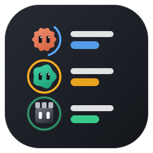
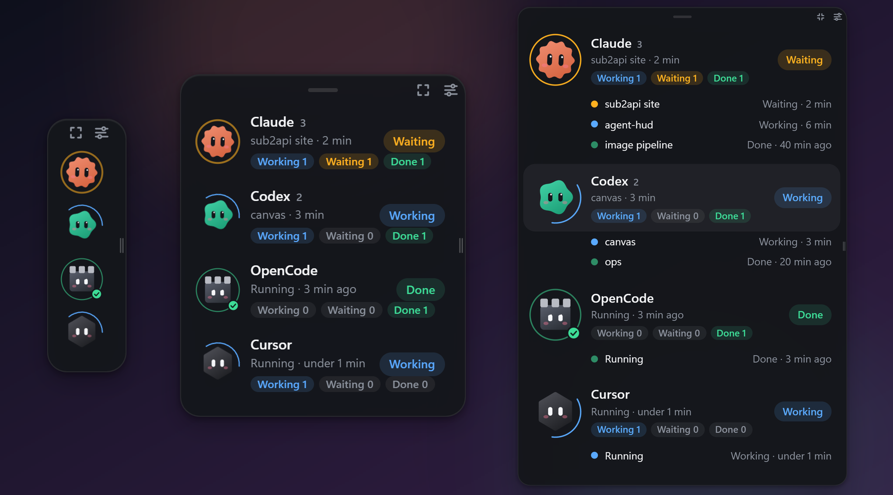
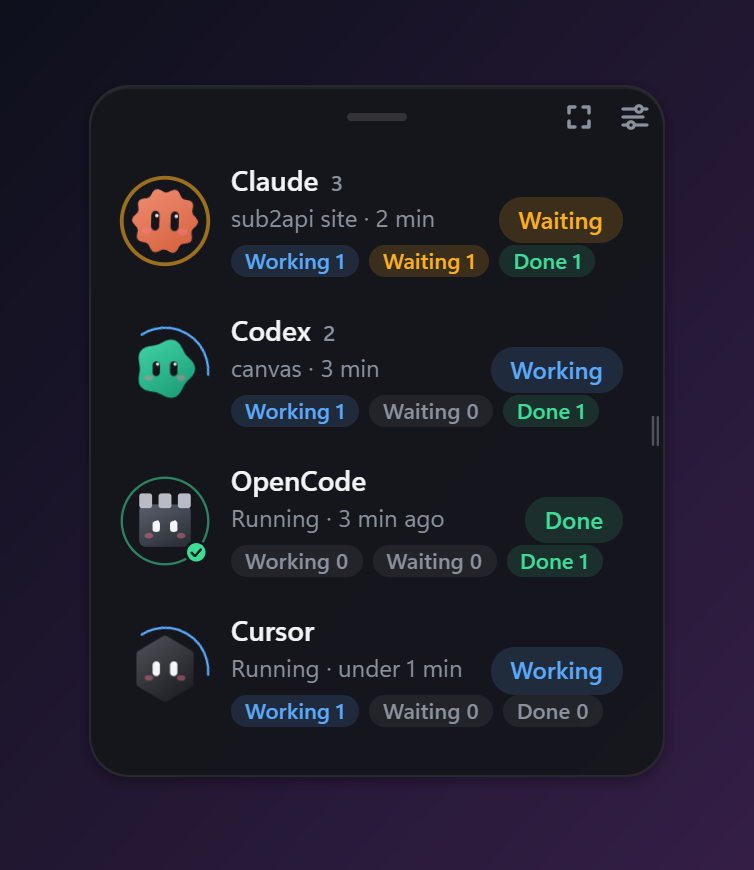
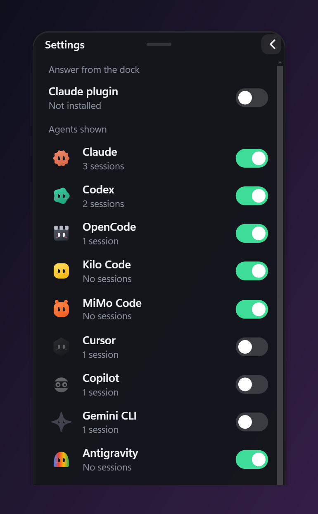
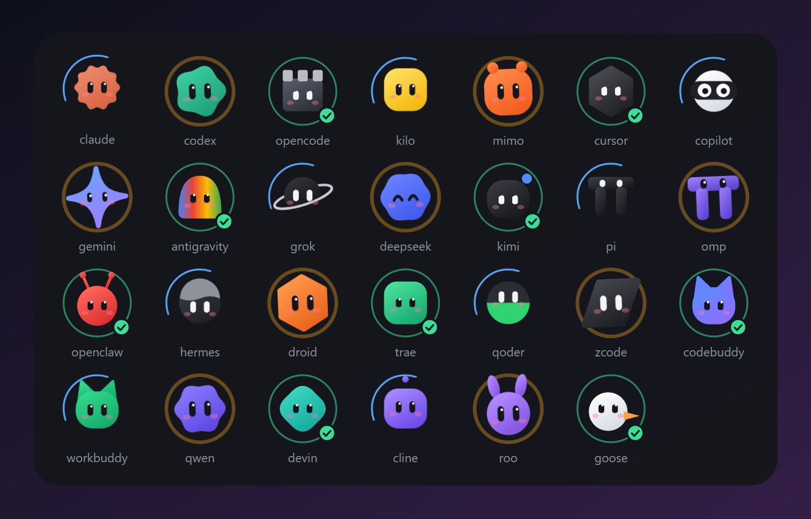

<p align="center">
  
</p>

<h1 align="center">Agent Dock</h1>

<p align="center">
  <strong>你的编程 Agent 是在工作、在等你，还是已经完成？</strong><br>
  一个始终置顶的小窗口，一眼看清 27 个 Agent 的状态。
</p>

<p align="center">
  <a href="https://www.microsoft.com/windows"></a>
  <a href="https://www.electronjs.org/"></a>
  <a href="https://nodejs.org/"></a>
  <a href="LICENSE"></a>
  
  
  
</p>

<p align="center">
  <a href="README.md">English</a> · <strong>简体中文</strong> ·
  <a href="#快速开始">快速开始</a> ·
  <a href="#支持的-agent">支持的 Agent</a> ·
  <a href="#工作原理">工作原理</a>
</p>

<p align="center">
  
</p>

你在 Claude Code 里开了一个任务，在 Codex 里开了第二个，在 OpenCode 里开了第三个，然后回去做自己的事。
Agent Dock 停在屏幕边缘，给每个 Agent 显示三种状态之一：

| 状态 | 含义 | 你看到的 |
| --- | --- | --- |
| **工作中** | Agent 正在忙 | 吉祥物上下浮动、眨眼，外圈蓝色转动 |
| **等你** | 需要你回答或批准 | 吉祥物放大，外圈琥珀色呼吸 |
| **已完成** | 这一轮结束了 | 安静的吉祥物，带绿色对勾 |

不需要先配置什么，只读取 Agent 本来就会写的文件。浮窗本身保持这么小；左上角的按钮可以切到**统计**。

## 功能

- **每个 Agent 一个吉祥物。** 27 个手绘形象，各有自己的形状和颜色。
- **随内容缩放。** 拖左右边缘，版式随宽度变化，从只有图标到带各状态数量的完整面板；高度始终跟随内容，不会被裁掉也没有空白。
- **点一行就展开。** 窗口变大显示这个 Agent 的所有会话；收起后回到之前的位置和大小。鼠标移到 Agent 行或会话行上会高亮，点下去会点到哪一行一目了然。
- **举手徽标和数量。** 吉祥物右下角显示一只举起的手和这个 Agent 有几个会话在等你；托盘提示里显示总数。
- **未读提醒。** Claude 或 Codex 的会话在 Agent Dock 盯着的时候做完了一轮，它的绿色圆圈和对勾会**闪烁**，直到你点一下它的那一行；其他靠文件活动判断的 Agent，只有在活动至少持续 30 秒后停下才会闪，意思是「活动停了」，不一定是「完成了」；如果它还有别的会话在工作，吉祥物上会有一个闪烁的绿色小点。托盘提示里会统计未读数量。
- **完成内容的简短摘要。** 对 Claude 和 Codex，你还没看过的已完成一轮会在绿色卡片里显示它的最后一条消息（大约三行）。你可以选择**打开聊天**、**不回复**（忽略它），或者对 Claude 直接在卡片里输入后续内容，作为你的下一条消息发出去（和回答问题一样，用的是可选的 Claude 插件）。
- **从窗口里打开聊天。** 点一下可以跳到对应会话的聊天：Claude 桌面版的会话（用桌面版自己的 `claude://code/continue` 链接，终端里的会话没有桌面聊天可跳）和 OpenCode（把它的窗口带到前面）。设置里有开关；只有一个会话的行会直接打开它的聊天，打不开时照常展开；有多个会话的行先展开，再点其中一个会话才会打开。
- **各状态数量。** 每个 Agent 显示 `工作中 2 · 等你 1 · 已完成 5`。
- **自选 Agent。** 设置里列出全部支持的 Agent，已安装的排在前面，每个都有开关。
- **English 和中文。** 默认英文，在设置里切换。
- **在窗口里回答。** Claude 桌面版在等你回答的问题会带着按钮和输入框出现，点一下，回答就送进那个会话（可选的 Claude 插件，默认关闭）。
- **默认只读。** 不修改任何 Agent 的配置，也不向外发送任何数据（除非你打开下面的手机功能）；只有你自己打开的可选 Claude 插件，才会给 Claude 加一个插件。
- **统计。** 浮窗左上角的按钮（或托盘菜单里的统计）会把整个窗口变成统计视图；再点同一个按钮或按 Esc，就回到原来的大小和位置。显示每个 Agent 何时在工作、何时在等你的时间线（Dock 运行期间才会记录）、按 Agent / 模型 / 项目分组的每日 token，以及会话表（token、估算费用、上下文大小），数据来自 Claude Code、Codex、OpenCode（它跑过的任何模型和供应商）和 Grok 本来就会写的记录。Kilo Code、MiMo Code、Gemini CLI、Qwen Code、Pi、Oh My Pi 和 Kimi 按它们源码里定义的格式读取，但还没有用这些 Agent 的真实数据测试过（Kimi 不记录模型名，所以显示为 `kimi`）。费用是这些 token 按按量付费标价算出的估值，不是你实际被扣的钱；价格表里没有的模型，会用 Agent 自己报告的费用（OpenCode、Grok、Kilo、MiMo Code、Pi 和 Oh My Pi 会报；报告的 0 会显示为 $0，本地模型这样是对的，但有些 Agent 对没有价格的模型也写 0），都没有才标为无价格，可在 `prices.json` 里补上。OpenCode 的数据需要可选的 `better-sqlite3`（见支持的 Agent 一节）；其余 Agent 要么本地不存 token 数（Cursor），要么只有按会话的合计（Copilot、Hermes），要么日志是压缩的（DeepSeek），要么格式没有足够文档可以放心读取（Droid、Goose、Cline、Roo），所以只出现在时间线里。
- **桌面快捷方式**，带全局启动键（`Ctrl+Alt+H`）。

## 下载

从[最新 release](https://github.com/kjw0716/agent-dock/releases/latest)下载 `Agent-Dock-Setup-<版本>.exe` 并运行。它按当前用户安装（不需要管理员权限），并添加开始菜单快捷方式。安装包没有代码签名，Windows SmartScreen 可能提示“Windows 已保护你的电脑”：点 **更多信息** > **仍要运行**。

## 从源码运行

需要 Windows 10 或 11、[Node.js](https://nodejs.org/) 20 及以上、Git。（截图脚本 `scripts/shoot.js` 需要 Node 22 及以上。）

```powershell
git clone https://github.com/kjw0716/agent-dock.git
cd agent-dock
npm install
npm start
```

创建桌面和开始菜单快捷方式（之后可以用 <kbd>Ctrl</kbd>+<kbd>Alt</kbd>+<kbd>H</kbd> 启动）：

```powershell
npm run shortcut
```

没有任何 Agent 在运行时，也可以先看演示：

```powershell
npm run demo
```

想开机自启，在设置里打开「开机自启」。

## 截图

<p align="center">
  
  &nbsp;&nbsp;
  
</p>

<p align="center">
  
</p>

## 使用

| 操作 | 效果 |
| --- | --- |
| 点某个 Agent 一行 | 把它完成的内容标为已读（绿色不再闪烁），并且窗口变大并显示它的会话；再点一下（或收起最后一行）回到原来的样子 |
| 点顶部的展开按钮 | 一次展开或收起全部 |
| 拖左右边缘 | 改变宽度和版式，高度跟随内容 |
| 拖顶部横条 | 移动窗口 |
| 点滑块按钮 | 设置：显示哪些 Agent、置顶、开机自启、语言、重置、退出 |
| 右键或托盘图标 | 重置位置和大小、退出 |

按宽度的版式：**只有图标** → **图标加状态** → **一行** → **一行加各状态数量** → **展开每个会话**。

## 支持的 Agent

Claude Code 和 Codex 有专门的读取器，其余 Agent 共用一个读取器，查看它们保存的文件。

| Agent | 状态来源 | 等你 | 在真机上验证 |
| --- | --- | :---: | --- |
| **Claude Code** | `~/.claude/sessions/<pid>.json`（`busy`、`waiting`、`idle`） | ✓ | 工作中、等你、已完成均已验证 |
| **Codex** | 最新的 `~/.codex/sessions/**/rollout-*.jsonl` | ✓（批准和提问） | 工作中和已完成已验证；等你只有单元测试 |
| **OpenCode** | `~/.local/share/opencode/opencode.db` 和程序进程 | – | 已确认文件位置和空闲时的表现；工作中未验证 |
| Kilo Code · MiMo Code · Cursor · GitHub Copilot · Gemini CLI · Antigravity · Grok · DeepSeek · Kimi · Pi · Oh My Pi · OpenClaw · Hermes · Factory Droid · TRAE · Qoder · ZCode · CodeBuddy · WorkBuddy · Qwen Code · Devin · Cline · Roo Code · Goose | 各自的会话目录或数据库，路径取自 agent-hud-open 的发现表 | – | 尚未验证 |

「等你」需要 Agent 自己暴露这个信息，目前只有 Claude Code 和 Codex 有，其余 Agent 只显示工作中或已完成。
标「尚未验证」的路径没有在本机测过；如果有错，改 [`agents.js`](agents.js) 里对应的一行即可。

## 在窗口里回答

当 Claude 桌面版用一个提问框结束一轮（下一步框，或开新会话的提议），这个问题会出现在窗口里，带上它的按钮和一个输入框。点一个回答或自己输入，它会作为你的下一条消息发给那个会话。

<p align="center">
  
</p>

这需要一个很小的 Claude Code 插件把消息送进会话。它**默认关闭**：在设置顶部打开 **Claude 插件**，Agent Dock 会替你运行 Claude 自己的命令行：

```powershell
claude plugin marketplace add ~/.agent-dock/claude-plugin
claude plugin install agent-dock@agent-dock --scope user
```

关掉开关就会卸载（`claude plugin uninstall` 和 `claude plugin marketplace remove`）。Claude 设置里的其他内容不会被改动，别的插件（包括原版 Agent HUD 的）原样保留。

- **插件做什么：** 每 5 秒在 `~/.agent-dock/channel/sessions/` 写一条「这个会话可以接收回答」；每秒查看 `~/.agent-dock/channel/prompts/<会话>/` 里有没有你点的回答，会话空闲时把它作为你的下一条消息提交。别的它都不碰。
- **已经打开的会话：** 安装之前就开始的会话没有加载插件，卡片会提示，新开一个会话即可在那里回答。
- **安全：** 回答只会送给提问的那个会话。问题在插件取走回答之前关闭，窗口会撤回它（大约一秒内）；一旦被取走，会话一空闲就会提交，所以恰好同时在 Claude 里输入，可能两条都会送出。回答两分钟后作废，每个问题只接受一次回答，以 `/`、`!`、`#` 开头的文字和控制字符会被拒绝。任何能写入 `~/.agent-dock/channel` 的人都能向你的 Claude 会话发消息，所以请让这个文件夹保持私有（它在你的用户目录下）。
- **已验证的部分：** 在加载了插件的无头 Claude Code 会话里，整个往返（报到、回答、以用户消息送达）都跑通了，安装和卸载也在一份临时的 Claude 配置上跑通了。在 Claude 桌面版里，每个已打开的会话都加载了插件，并以窗口读取的同一个会话 ID 报到；在桌面版里点一下就回答的完整往返还没有测过。
- **暂不支持：** Claude 的工具授权请求和多选的 AskUserQuestion 工具，仍然需要在 Claude 里回答。

## 工作原理

- **提问：** 对空闲的 Claude 会话，Agent Dock 读取它转录文件的末尾；你最后一条真实消息之后出现下一步框或会话提议，就说明它在等你，并显示问题和按钮。只用解析出的工具调用，不使用转录里的其他文字。
- **Claude Code** 为每个运行中的进程保存一个登记文件。Agent Dock 读取其中的 `status`，忽略进程已退出的条目：`busy → 工作中`、`waiting → 等你`、`idle → 已完成`。
- **Codex** 每个事件写一行 JSON。Agent Dock 读取最新会话文件的末尾：`task_started` 是工作中，`task_complete` 或 `turn_aborted` 是已完成，没回答的提问或批准是等你。工作中的一轮静默超过 30 分钟按已完成算；没回答的提问或批准会一直保持「等你」。
- **其他 Agent：** 会话文件在最近 12 秒内有写入算工作中；程序在运行，或 6 小时内有活动算已完成；更久的不显示。
- 运行中的程序列表来自 `tasklist`，每 5 秒异步刷新，不会卡住界面。

Claude 的 `waiting` 字段不是公开接口，不同版本的 Claude Code 可能会变。

## 你的数据

- 除非你打开手机功能，数据不会离开你的电脑：打开后，你配对的手机可以通过 Tailscale 看到 Dock 显示的内容（Agent 状态、会话名、问题或已完成的回复），打开可选的「对话」开关后还包括你最近的 Claude Code 和 Codex 对话的完整文字（见手机一节）；如果打开通知，带 Agent 名称和状态的推送会通过手机浏览器厂商的推送服务发到手机（或发到你的 Bark 地址）。不开手机功能就没有任何网络请求。
- 不会修改任何 Agent 自己的配置。唯一的例外是可选的 Claude 插件，只有你打开开关才会安装（见上文）。
- Agent Dock 在 `~/.agent-dock/` 下写文件：`config.json`（位置、宽度、启用的 Agent、语言）和 `state.json`（最近显示的状态，不含任何问题文字），打开 Claude 插件后还有 `channel/` 和 `claude-plugin/`。Dock 运行时还会写 `history/`（每次状态变化一行：Agent、会话 id、会话名、状态、时间），从第一次启动就开始记。打开统计后会增加 `usage-index.json`（按天、模型、项目文件夹统计的 token 数；每个会话的合计、标题和工作目录；每个读过的会话记录的路径和读取位置），以及你自己创建的 `prices.json`。这里不存任何消息正文。Claude Code 之后删掉的会话记录，它们的统计会保留；如果某个已有的会话记录被改写，索引会按磁盘上还在的内容重建。
- 没有「对话」开关时，除了你在窗口里看到的，不会读取消息内容用于显示（打开后，手机打开某个对话时才会从 Agent 自己的记录文件读取它，见手机一节）：会话名（没有时用项目文件夹名）、事件类型和时间戳、Claude 在等的提问（问题、摘要和按钮），以及你还没看过的已完成 Claude 或 Codex 一轮的最后一条消息。这些文字只保存在内存里，不会写到磁盘。

## 手机

默认关闭（设置 → 手机访问）。Dock 里有一个只监听 `127.0.0.1` 的小型网页服务；手机通过 **Tailscale**（`tailscale serve`：只在你自己的 tailnet 里走 HTTPS，不经过公网，Dock 从不使用 `funnel`）访问它。需要电脑和手机都装 Tailscale 并登录同一个账号，并且在 tailnet 里打开 HTTPS 证书（Tailscale 管理后台 → DNS）。

1. 设置 → 手机访问 → 打开。Tailscale 准备好后点**发布到手机**。
2. 点**配对手机**，用手机相机扫二维码（一次性配对码，2 分钟内有效），再把网页添加到主屏幕。
3. 一个列表显示所有对话，最新在前，每条带 Agent 的图标和状态（等你、工作中、已完成），点一下就能打开。顶部的筛选标签可按 Agent 过滤，**加载更多**往更早翻。Claude 在等你回答的问题会直接出现在列表里（打开对话后也在输入框上方）：可以回答、发后续指令或忽略（和 Dock 本身一样，只有装了插件的 Claude 可以回答，其他 Agent 只能看）。
4. 可选通知，两种方式（可以只用一种或都用）。**在手机页面点右上角的铃铛**：之后这台手机会在 Agent 等你回答或完成时收到通知，点开直接进入那个对话。这是标准的网页推送（不用装别的 App，也不用粘贴地址）：iPhone（iOS 16.4 及以上）需要先把页面添加到主屏幕，再从主屏幕图标打开；Android 直接用浏览器即可（Chrome 依赖 Google 的推送服务，没有 Google 服务的手机用不了）。通知文字只有 Agent 名称和发生了什么（"Claude · 等你回答"），不含问题、回复或会话名；内容为这台手机加密，经浏览器厂商的推送服务（Apple、Google 或 Mozilla）转发，推送服务只知道有一条消息和它发给哪台手机。签名推送用的密钥对在这台电脑上生成（`~/.agent-dock/push-keys.json`），推送服务从中只能知道本项目的公开地址。撤销手机会同时删除它的订阅；手机上的 Tailscale 关着也能收到通知（只有打开页面才需要它）。**或者用 Bark：**在设置里填你的 [Bark](https://github.com/Finb/Bark) 地址，同样的短文字，加上由你的 tailnet 地址和对话 id 组成的链接，会经过地址里的 Bark 服务器（默认 `api.day.app`，除非你自己部署），这是第三方。两种方式合计每分钟最多推送 6 条。
5. 可选，默认关闭：**手机上的对话**（设置 → 手机访问 → 对话）。打开后列表里会有你最近的 Claude Code、Codex、OpenCode 和 Grok 对话；点进去可以看完整对话（你的消息、回复，以及每次工具调用的一行摘要）并继续发消息，或点右上角的**新建**，选 Agent，在你在电脑上添加的文件夹里开始新对话（添加文件夹）。Claude、Codex 和 OpenCode 可以发消息；Grok 暂时只能查看（它的无界面模式在这里无法验证）。每条消息都可以从电脑提供的列表里选模型和思考档位（Claude：Fable、Opus、Sonnet、Haiku 及其思考档位；Codex：你安装的 Codex 提供的模型和档位；OpenCode：`opencode-cli models` 给出的 `provider/model` 列表和 `medium` / `high` 变体）。每条消息会在这台电脑上运行一次无界面的 `claude -p`、`codex exec` 或 `opencode-cli run --standalone`，接着同一个对话继续（同时最多 4 个，每个最长一小时），点停止即可结束。
   - **权限。** 默认 Claude 对话只能用文件工具（读、改、写、搜索：不能执行命令，不加载 MCP 服务器），Codex 对话在 Codex 的只读沙箱里运行，OpenCode 对话运行它的只读 `plan` agent，并且关闭文件夹自带的 `opencode.json` 和插件，对话只能在你添加的文件夹里进行。单独的开关**全部权限（不弹窗）**会去掉这些限制：对话可以在任何文件夹里做 Agent 在这台电脑上能做的一切，不会先询问。它只存在于这台电脑上（手机无法打开），关闭"对话"时会自动关闭。只有信任所有已配对手机时才打开，因为已配对的手机之后可以以你的身份运行任何东西。
   - **电脑上正打开着的对话**（有这个 id 的 Claude 进程还活着，或者记录在 3 分钟内有变化）不会被 Dock 同时写入：消息会在一个副本里继续（Claude：`--fork-session`；Codex：`codex exec fork`），手机自动切换过去。因为 Codex 和 OpenCode 看不到进程，所有不是 Dock 自己启动的 Codex 或 OpenCode 对话第一次都会在副本里继续（`--fork`）；之后只要 Dock 在运行，就在这个副本里原地继续。你自己通过手机完成的轮次不算别人在写。
   - **隐私。** 对话功能会把完整对话文字（包括工具调用行）发给每一台已配对的手机，工具输出里可能有密钥或个人数据。和其他操作一样，读取也必须通过 Tailscale 的 HTTPS 地址。OpenCode 对话从它的数据库只读读取，Grok 对话从 `~/.grok/sessions` 读取。没有全部权限时 Claude 以受限模式运行（忽略设置文件，也不能写设置或 git 配置），Codex 完全不能写文件，OpenCode 的 plan agent 只读，但 Claude 对话仍可以修改允许文件夹里的普通文件，包括你之后可能运行的脚本：只添加你放心的文件夹。手机也能看到允许文件夹的名称和完整路径。“只在这些文件夹里”指的是对话的工作位置，不保证 Agent 读不到别处的文件：OpenCode 的 plan agent 仍可能读取其他文件并访问网页，所以埋在你添加的文件夹里的恶意文本可能诱导它把东西发出去；不要把不可信的内容放进添加的文件夹。
   - 只有最新的若干个对话会被列出（Codex 只看最近 90 天）。

怎么保护：每个请求都要有配对生成的设备令牌（`~/.agent-dock/phone.json` 里只存哈希）；令牌绑定它第一次用的 Tailscale 账号（只要 `tailscale serve` 带了登录头就会检查）；`Host` 必须是这台电脑的 tailnet 名称，或带 Dock 端口的本机回环地址（防止其他网页，包括 DNS 重绑定，访问这个服务）；会改变东西的操作（回答、忽略、发送、启动或停止）以及所有对话读取，如果不是经过 `tailscale serve`、或者 `Origin` 不匹配，一律拒绝；配对码只能用一次，猜错会被限速。手机只用一个不透明的 id 指代对话，由 Dock 在自己建的记录索引里查找：手机给的文件路径或工作目录从来不会被使用，模型和思考档位只接受电脑给出的列表，页面把对话文字当作纯文本显示。可以在设置里撤销单个或全部手机。发布会占用这台电脑 tailnet 名称的 HTTPS 443 端口（如果已被别的服务使用，Dock 会拒绝，也从不使用 `funnel`）；关闭手机访问会停掉服务并取消发布，但如果 Dock 在开启状态下退出或崩溃，发布会一直保留，直到你运行 `tailscale serve --https=443 off`，或重新启动 Dock 再关闭。还没做的：从手机批准工具权限（没有全部权限时对话不会询问，只是做不了那些事）。

## 配置

| 设置 | 方式 |
| --- | --- |
| Agent、置顶、开机自启、语言 | 设置（滑块按钮） |
| 数据目录 | 环境变量 `AGENT_DOCK_DATA` |
| 状态组合变化时保存窗口截图 | 环境变量 `AGENT_DOCK_SHOT_DIR` |
| 手机访问、对话、Bark 地址、允许的文件夹 | 设置 → 手机访问（保存在 `config.json` 的 `phone` 和 `bark`） |
| 演示数据 | `npm run demo` |

## 开发

```powershell
npm test                                   # 读取器和状态归约，使用注入的时钟和文件系统
npx electron scripts/render-svg.js assets/logo.svg assets/icon-512.png 512   # 渲染图标（要用 Electron，不能用 node 直接跑）
```

```text
main.js        窗口、托盘、缩放、设置、轮询
sources.js     Claude Code 和 Codex 的读取器、按 Agent 汇总
agents.js      其余 25 个 Agent：路径、程序名、工作中/已完成规则
index.html     整个界面：27 个吉祥物、各种版式、设置、中英文
preload.js     页面允许调用的少数几个接口
scripts/       图标渲染、截图、快捷方式创建
test/          node:test 测试
```

## 后续计划

- 在更多真机上验证各 Agent 的路径，并在 Agent 提供时支持「等你」。
- 在窗口里回答 Claude 的工具授权请求和 AskUserQuestion 提问。
- Agent 开始等你时可选的提示音或通知。

## 致谢与许可

布局思路、「每个 Agent 一个吉祥物」的想法，以及各 Agent 文件位置表，来自
[jazzenchen/agent-hud-open](https://github.com/jazzenchen/agent-hud-open)（Apache-2.0）。那是一个大得多的项目，
支持 macOS、Windows、Linux，还有额度、批准、手机端等。本项目是对其最简模式的 Windows 小实现，从零编写，
没有复制其代码或图片素材。见 [NOTICE](NOTICE)。

Agent 的名称和颜色归各自所有者。吉祥物是原创绘制，不是官方标志。

使用 [Apache License 2.0](LICENSE) 许可。

<sub>建议的 GitHub 主题标签：`windows` `electron` `desktop-widget` `hud` `ai-agents` `coding-agents` `claude-code` `codex` `opencode` `cursor` `gemini-cli` `github-copilot` `developer-tools`</sub>
